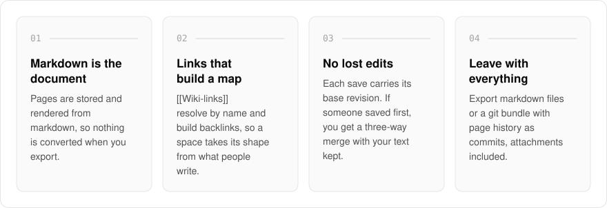
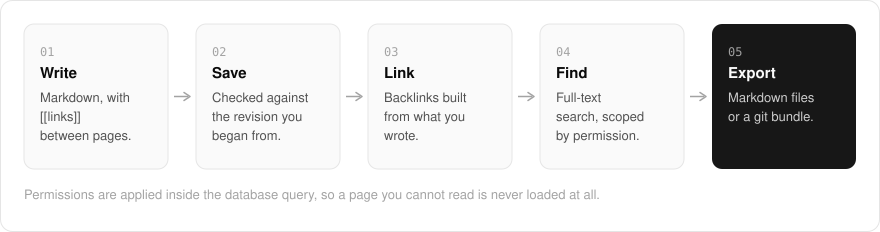

  <picture>
    <source media="(prefers-color-scheme: dark)" srcset=".github/assets/hero-dark.png">
    
  </picture>

<h1 align="center">know.me.at</h1>

<strong>A team wiki you can take with you.</strong>

  
  
  
  

  <a href="#features">Features</a> ·
  <a href="#how-it-works">How it works</a> ·
  <a href="#built-with">Built with</a>

Many wikis keep your writing in a format only they can read, so leaving means a lossy export and a lost history. I built know.me.at as a team wiki for small teams where pages are saved as plain markdown: leaving is a copy of your files, with every page's history as git commits. Permissions are checked inside the database query, so a page you cannot read is never loaded at all. It is spaces, collections and pages done completely, without the weight of a blocks platform: no realtime co-editing, no whiteboards.

  <picture>
    <source media="(prefers-color-scheme: dark)" srcset=".github/assets/overview-dark.svg">
    
  </picture>

## Why know.me.at

| The usual team wiki | know.me.at |
| --- | --- |
| Content stored in a private block format | Plain markdown is what gets saved |
| Export is a conversion | Markdown files or a git bundle, with page history as commits |
| The last save wins | A conflicting save opens a three-way merge with your text still in it |
| Pages filtered after they are loaded | Permissions applied inside the query, and search follows the same rules |

## Features

- **Markdown is what gets saved**: pages are stored and rendered from markdown, and nothing is converted when you export.
- **Wiki-links and backlinks**: `[[links]]` between pages resolve by name and build backlinks, so a space gets its shape from what people write.
- **Revisions you can diff**: each page keeps its history under a retention policy, with a diff between versions.
- **Conflicting saves open a merge view**: each save carries the revision it started from, and if someone saved first, you get a three-way merge with your text still in it.
- **Permissions per collection**: read and write access applied inside the query, and search follows the same rules.
- **Take it with you**: export as an archive of markdown files or as a git bundle with page history as commits, attachments included.

## How it works

  <picture>
    <source media="(prefers-color-scheme: dark)" srcset=".github/assets/flow-dark.svg">
    
  </picture>

You write a page in markdown, and each save is checked against the revision you started from, so a conflict becomes a merge instead of a lost edit. The `[[links]]` you write build the backlinks between pages, and Postgres full-text search finds pages under the same permissions as reading them. Because the stored markdown is the document, an export hands back exactly what was saved.

## Built with

  
  
  
  
  
  
  

- Next.js 16 (App Router), React 19, TypeScript
- Tailwind CSS 4
- Drizzle ORM + Postgres (with Postgres full-text search)
- Better Auth (the shared me.at account)
- unified / remark markdown pipeline, Mermaid diagrams, DOMPurify

## Part of the me.at family

know.me.at is one of my [`*.me.at`](https://me.at) apps. They share one design system, account, and app shell. Development happens in a private monorepo; this repository is the project's public-facing home.

## License

Source-available. See [LICENSE](LICENSE).
