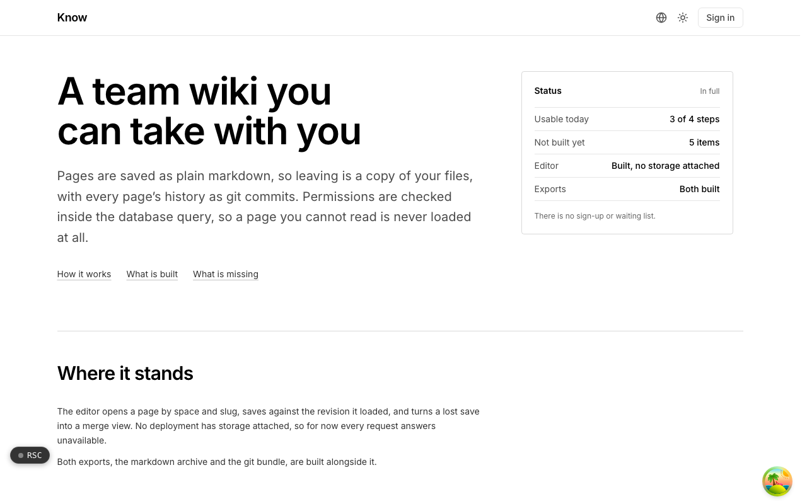

  <picture>
    <source media="(prefers-color-scheme: dark)" srcset=".github/assets/hero-dark.png">
    
  </picture>

# know.me.at

A team wiki you can take with you.

Know is a team wiki and knowledge base for small teams: spaces, collections and pages, written in markdown. Pages are saved as plain markdown, so leaving is a copy of your files, with every page's history as git commits. Permissions are checked inside the database query, so a page you cannot read is never loaded at all. It aims at small-team docs without the weight of a blocks platform: no realtime co-editing, no whiteboards, just pages and collections done completely.

## Features

- **Markdown is what gets saved**: pages are stored and rendered from markdown, and nothing is converted when you export.
- **Wiki-links and backlinks**: `[[links]]` between pages resolve by name and build backlinks, so a space gets its shape from what people write.
- **Revisions you can diff**: each page keeps its history under a retention policy, with a diff between versions.
- **Conflicting saves open a merge view**: each save carries the revision it started from; if someone saved first, you get a three-way merge with your text still in it.
- **Permissions per collection**: read and write access applied inside the query, and search follows the same rules.
- **Take it with you**: export as an archive of markdown files or as a git bundle with page history as commits, attachments included.

## Built with

- Next.js 16 (App Router), React 19, TypeScript
- Tailwind CSS 4
- Drizzle ORM + Postgres (with Postgres full-text search)
- Better Auth (the shared me.at account)
- unified / remark markdown pipeline, Mermaid diagrams, DOMPurify

## Part of the me.at family

know.me.at is one of the [`*.me.at`](https://me.at) apps by Trevor McDougald. They share one design system, account, and app shell. Development happens in a private monorepo; this repository is the project's public-facing home.

## License

See [LICENSE](LICENSE).
